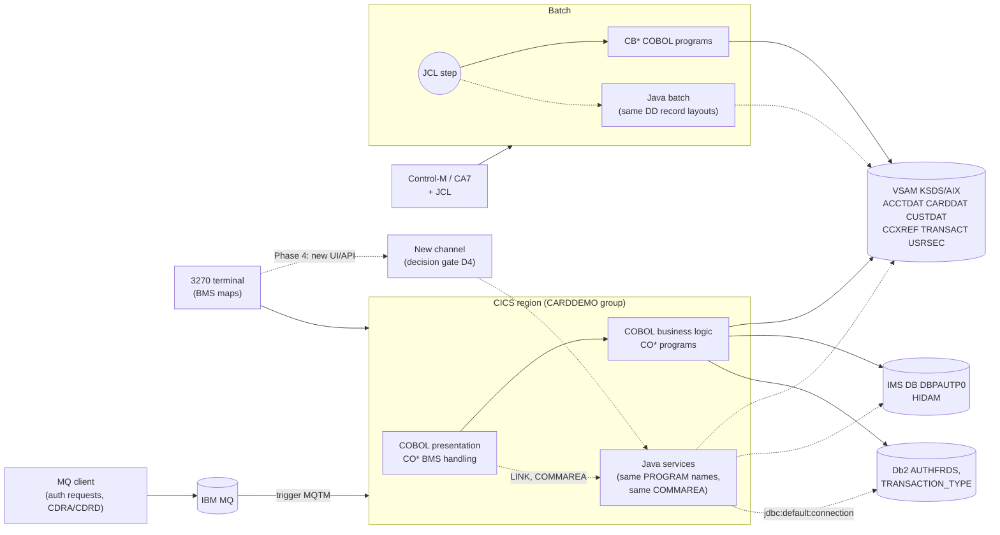

# CardDemo COBOL to Java Migration Plan (Strangler Fig)

This is a phased plan for moving the CardDemo COBOL programs (CICS online, batch, and the optional Db2, IMS and MQ extensions) to Java. Each program is replaced one at a time behind its existing interface, and every step can be rolled back. Everything below was taken from the source on `main`. File paths are relative to the repository root.

## Table of Contents
- [Scope](#scope)
- [Current-State Inventory](#current-state-inventory)
- [Target Architecture](#target-architecture)
- [Migration Principles](#migration-principles)
- [Data Type Catalog](#data-type-catalog)
- [Transaction and Error Semantics](#transaction-and-error-semantics)
- [Phases](#phases)
- [Assembler and Non-COBOL Work Items](#assembler-and-non-cobol-work-items)
- [Cross-Cutting Controls](#cross-cutting-controls)
- [Known Defects to Preserve](#known-defects-to-preserve)
- [Open Decisions](#open-decisions)
- [Risk Summary](#risk-summary)

## Scope

- **Plan only; no source changes.** This document does not change any COBOL, copybook, BMS, JCL, CSD, DDL, DBD/PSB or data file.
- In scope: the 31 programs in `app/cbl`, the 8 in `app/app-authorization-ims-db2-mq/cbl`, the 3 in `app/app-transaction-type-db2/cbl`, the 2 in `app/app-vsam-mq/cbl`, and the copybooks, BMS maps, CSD definitions and JCL that go with them.
- Out of scope: the IDCAMS/SORT/IEBGENER/SDSF/FTP/TXT2PDF/DSNTEP4/DSNTIAUL utility jobs. They are replaced by platform tooling in Phase 5 and are not converted to Java. The `samples/m2` runtime zips are also out of scope.
- No runtime decisions have been made yet. The [Open Decisions](#open-decisions) section lists them, and each one is tied to the phase that needs it.

## Current-State Inventory

### What the repository does and does not contain

| Expected by a typical migration plan | Found in CardDemo |
|:---|:---|
| API layer (z/OS Connect `openapi.yaml`, `zosAsset.yaml`) | **None.** The only external interfaces are 3270 BMS screens, MQ queues (extensions), batch files and TDQ `JOBS`. |
| Web/mobile frontend with routing rules | **None.** Routing is the CICS `PROGRAM`/`TRANSACTION` definitions in the CSD, plus the menu tables `app/cpy/COMEN02Y.cpy` and `app/cpy/COADM02Y.cpy` that drive `XCTL`. |
| COMMAREA vs channel/container programs | Online programs use only COMMAREAs. No program uses `GET CONTAINER`/`PUT CONTAINER`/`CHANNEL`. A third interface type exists: MQ-triggered programs that `EXEC CICS RETRIEVE` an MQ trigger message (`MQTM`). |
| PL/I | **None.** The only non-COBOL code is two assembler modules (`app/asm/COBDATFT.asm`, `app/asm/MVSWAIT.asm`). |
| Build config (`dbb-app.yaml`, `zapp.yaml`) | **None.** Compile options come from `samples/proc/BUILDONL.prc` (`CICS,NODYNAM,RENT,NOSEQ`), `samples/proc/BUILDBAT.prc` (`APOST,LIST,MAP,NUMBER,NOSEQ`), `samples/proc/BLDCIDB2.prc` and `samples/jcl/IMSMQCMP.jcl`. `TRUNC` is set nowhere, so the compiler default `TRUNC(STD)` applies. |
| CCSID declaration | **None** for VSAM and MQ data. `app/app-transaction-type-db2/ctl/DB2CREAT.ctl` only declares `CCSID EBCDIC`. The data ships as `app/data/EBCDIC` and `app/data/ASCII`. |
| Existing Java | **None on `main`.** |

### Online programs (CICS)

All online programs except the MQ-triggered ones receive `CARDDEMO-COMMAREA` (`app/cpy/COCOM01Y.cpy`). They are pseudo-conversational: they `RETURN TRANSID` and navigate with `XCTL PROGRAM(CDEMO-TO-PROGRAM)`. **Every online program is BMS-only.** No API route exists for any of them.

| Tran | Program | CSD | Interface | Files / resources | Writes? | Callers (XCTL/LINK) |
|:---|:---|:---|:---|:---|:---|:---|
| CC00 | COSGN00C | `app/csd/CARDDEMO.CSD` | COMMAREA + BMS COSGN00 | USRSEC (read) | No | Terminal entry; XCTLs to COADM01C / COMEN01C |
| CM00 | COMEN01C | base | COMMAREA + BMS COMEN01 | none | No | COSGN00C; menu table COMEN02Y (11 options) |
| CA00 | COADM01C | base | COMMAREA + BMS COADM01 | none | No | COSGN00C; admin table COADM02Y (6 options) |
| CAVW | COACTVWC | base | COMMAREA + BMS COACTVW | ACCTDAT, CUSTDAT, CXACAIX (read) | No | COMEN02Y option 1 |
| CAUP | COACTUPC | base | COMMAREA + BMS COACTUP | ACCTDAT, CUSTDAT (`READ UPDATE`/`REWRITE`), CXACAIX | **Yes** | COMEN02Y option 2 |
| CCLI | COCRDLIC | base | COMMAREA + BMS COCRDLI | CARDDAT, CARDAIX (browse) | No | COMEN02Y option 3; XCTLs to COCRDSLC / COCRDUPC |
| CCDL | COCRDSLC | base | COMMAREA + BMS COCRDSL | CARDDAT, CARDAIX (read) | No | COMEN02Y option 4, COCRDLIC |
| CCUP | COCRDUPC | base | COMMAREA + BMS COCRDUP | CARDDAT (`READ UPDATE`/`REWRITE`) | **Yes** | COMEN02Y option 5, COCRDLIC |
| CT00 | COTRN00C | base | COMMAREA + BMS COTRN00 | TRANSACT (browse) | No | COMEN02Y option 6 |
| CT01 | COTRN01C | base | COMMAREA + BMS COTRN01 | TRANSACT (read) | No | COMEN02Y option 7 |
| CT02 | COTRN02C | base | COMMAREA + BMS COTRN02 | TRANSACT (browse + `WRITE`), CCXREF, CXACAIX | **Yes** | COMEN02Y option 8; `CALL 'CSUTLDTC'` |
| CR00 | CORPT00C | base | COMMAREA + BMS CORPT00 | `WRITEQ TD QUEUE('JOBS')`: submits JCL for proc TRANREPT (CBTRN03C) | Yes (job submit) | COMEN02Y option 9; `CALL 'CSUTLDTC'` |
| CB00 | COBIL00C | base | COMMAREA + BMS COBIL00 | ACCTDAT (`READ UPDATE`/`REWRITE`), CXACAIX, TRANSACT (`WRITE`) | **Yes (money)** | COMEN02Y option 10 |
| CU00–CU03 | COUSR00C–COUSR03C | base | COMMAREA + BMS COUSR00–03 | USRSEC (browse / `WRITE` / `REWRITE` / `DELETE`) | Yes | COADM02Y options 1–4 |
| CDV1 | **COCRDSEC** | base | — | — | — | **Defined in CSD but there is no source in the repo** |
| CPVS | COPAUS0C | `app/app-authorization-ims-db2-mq/csd/CRDDEMO2.csd` | COMMAREA + BMS COPAU00 | ACCTDAT, CUSTDAT, CXACAIX; IMS `GU`/`GNP` | No | COMEN02Y option 11, guarded by `EXEC CICS INQUIRE PROGRAM` |
| CPVD | COPAUS1C | ext | COMMAREA + BMS COPAU01 | IMS `GU`/`GNP`/`REPL`; `LINK COPAUS2C` | **Yes** | COPAUS0C |
| — | COPAUS2C | ext | COMMAREA `WS-FRAUD-DATA` (LINK target) | Db2 `INSERT`/`UPDATE CARDDEMO.AUTHFRDS` | **Yes** | `LINK` from COPAUS1C only |
| CP00 | COPAUA0C | ext | **MQ trigger** (`RETRIEVE INTO(MQTM)`), MQGET request / MQPUT1 reply | ACCTDAT, CUSTDAT, CCXREF; IMS `GU`/`REPL`/`ISRT` | **Yes (authorization)** | MQ trigger monitor |
| CTLI | COTRTLIC | `app/app-transaction-type-db2/csd/CRDDEMOD.csd` | COMMAREA + BMS COTRTLI | Db2 cursors, `DELETE`/`UPDATE` TRANSACTION_TYPE | Yes | COADM02Y option 5 (no guard) |
| CTTU | COTRTUPC | ext | COMMAREA + BMS COTRTUP | Db2 `INSERT`/`UPDATE` TRANSACTION_TYPE | Yes | COADM02Y option 6 (no guard), COTRTLIC |
| CDRD | CODATE01 | `app/app-vsam-mq/csd/CRDDEMOM.csd` | **MQ trigger** (`RETRIEVE`), MQGET/MQPUT | none | No | MQ trigger monitor |
| CDRA | COACCT01 | ext | **MQ trigger** (`RETRIEVE`), MQGET/MQPUT | ACCTDAT (read) | No | MQ trigger monitor |

CICS files (base CSD): ACCTDAT, CARDDAT, CARDAIX, CCXREF, CUSTDAT, CXACAIX, TRANSACT, USRSEC. Transient data queue: JOBS.

### Batch programs

| Job (`app/jcl` or extension `jcl/`) | Program | Interface | Files | Writes? |
|:---|:---|:---|:---|:---|
| POSTTRAN | CBTRN02C | Sequential + VSAM | DALYTRAN (in), TRANFILE, XREFFILE, DALYREJS, ACCTFILE, TCATBALF | **Yes (posting)** |
| INTCALC | CBACT04C | `PROCEDURE DIVISION USING EXTERNAL-PARMS`, `PARM='2022071800'` | TCATBALF, XREFFILE, DISCGRP, ACCTFILE, TRANSACT | **Yes (interest)** |
| TRANREPT (also submitted from CORPT00C) | CBTRN03C | Sequential + VSAM | TRANFILE, CARDXREF, TRANTYPE, TRANCATG, DATEPARM, TRANREPT | Report only |
| CREASTMT | CBSTM03A → `CALL 'CBSTM03B'` (13 call sites, `LK-M03B-AREA`) | Batch + subroutine | STMTFILE, HTMLFILE; CBSTM03B owns TRNXFILE, XREFFILE, CUSTFILE, ACCTFILE | Report only |
| CBEXPORT / CBIMPORT | CBEXPORT, CBIMPORT | Sequential (`CVEXPORT.cpy`, multi-record) | All masters ↔ EXPFILE | Yes (migration extract/load) |
| READACCT / READCARD / READXREF / READCUST | CBACT01C (calls `COBDATFT` asm), CBACT02C, CBACT03C, CBCUS01C | Sequential | One master each | Diagnostic dumps |
| WAITSTEP | COBSWAIT → `CALL 'MVSWAIT'` (asm) | — | — | No |
| *(no JCL)* | **CBTRN01C** | Sequential + VSAM | DALYTRAN, CUSTFILE, XREFFILE, CARDFILE, ACCTFILE, TRANFILE | No (validation only). **Orphaned:** referenced only inside the `samples/m2` runtime zips. |
| — | CSUTLDTC | `PROCEDURE DIVISION USING LS-DATE, LS-DATE-FORMAT, LS-RESULT` | — | Date-validation subroutine (CEEDAYS) called by COTRN02C and CORPT00C |
| CBPAUP0J | CBPAUP0C (BMP via DFSRRC00) | IMS PCB masks | DBPAUTP0 `GN`/`GNP`/`DLET`/`CHKP` | **Yes (purge)** |
| LOADPADB / UNLDPADB / UNLDGSAM | PAUDBLOD, PAUDBUNL, DBUNLDGS | `ENTRY 'DLITCBL'`, `CALL 'CBLTDLI'` | DBPAUTP0, sequential / GSAM | Load/unload utilities |
| MNTTRDB2 | COBTUPDT (IKJEFT01) | Sequential + static SQL | INPFILE, TRANSACTION_TYPE | Yes |

The schedulers (`app/scheduler/CardDemo.controlm`, `CardDemo.ca7`) cover CLOSEFIL, COMBTRAN, DISCGRP, INTCALC, MNTTRDB2, OPENFIL, TRANBKP, TRANEXTR and WAITSTEP. The batch window closes the CICS files (CLOSEFIL) before the VSAM batch jobs run and reopens them afterwards (OPENFIL).

### Classification

| Class | Programs |
|:---|:---|
| API-exposed | **None.** There is no API layer. |
| BMS-only online | COSGN00C, COMEN01C, COADM01C, COACTVWC, COACTUPC, COCRDLIC, COCRDSLC, COCRDUPC, COTRN00C, COTRN01C, COTRN02C, CORPT00C, COBIL00C, COUSR00C–03C, COPAUS0C, COPAUS1C, COTRTLIC, COTRTUPC |
| Online, no terminal (LINK target) | COPAUS2C |
| Online, MQ-triggered | COPAUA0C, CODATE01, COACCT01 |
| Batch business | CBTRN02C, CBACT04C, CBTRN03C, CBSTM03A/CBSTM03B, CBPAUP0C, COBTUPDT |
| Batch utility / diagnostic | CBACT01C, CBACT02C, CBACT03C, CBCUS01C, CBTRN01C (orphan), COBSWAIT |
| Setup / loader / data migration | CBEXPORT, CBIMPORT, PAUDBLOD, PAUDBUNL, DBUNLDGS |
| Shared subroutine | CSUTLDTC, CBSTM03B, COBDATFT (asm), MVSWAIT (asm) |

## Target Architecture

The strangler seam is the **CICS program boundary**. A Java program is deployed under the same CICS `PROGRAM` name, or is reached through a COBOL presentation shell that `LINK`s to it. It receives the same COMMAREA bytes, so callers (`XCTL` from the menus, MQ trigger monitor, JCL `EXEC PGM=`) do not change. Dashed edges are strangler targets.

## Migration Principles

1. **Interfaces stay byte-identical.** This covers `CARDDEMO-COMMAREA` (160 bytes per `COCOM01Y.cpy`, plus each program's private trailer appended after `LENGTH OF CARDDEMO-COMMAREA`), `WS-FRAUD-DATA`, the MQ request/reply layouts `CCPAURQY`/`CCPAURLY`, every VSAM record length, every batch DD record layout, and IMS segment sizes (PAUTSUM0 100 bytes, PAUTDTL1 200 bytes).
2. **The program boundary is the seam.** Only one program moves at a time. Callers never learn which language served them.
3. **Parity first, fixes later.** Defects that exist today are reproduced exactly. They are listed in [Known Defects to Preserve](#known-defects-to-preserve) and fixed only after parity is signed off.
4. **Decimal arithmetic uses `BigDecimal`, never `double`.** The scale comes from the PIC clause. The default rounding is `RoundingMode.DOWN`, because no `COMPUTE` in the money paths uses `ROUNDED`. High-order truncation is emulated because `TRUNC(STD)` is in force and no money path uses `ON SIZE ERROR`.
5. **One unit of work.** Java code in CICS runs inside the CICS task's UOW. VSAM goes through JCICS file APIs, IMS through the CICS DL/I interface, and Db2 through the CICS-attached `jdbc:default:connection`. Separate JDBC connections, Spring `@Transactional` and XA managers are **forbidden** inside CICS.
6. **Every program can be rolled back individually** with a switch (see [Cross-Cutting Controls](#cross-cutting-controls)).
7. **Batch replacements read and write the same datasets** with the same record layouts, so the JCL step can switch between COBOL and Java with no change to upstream or downstream steps.

## Data Type Catalog

### Where each data type actually occurs

| Copybook(s) | Contents | Notes |
|:---|:---|:---|
| `COCOM01Y` (COMMAREA) | `PIC X`, unsigned `PIC 9` DISPLAY only (`CDEMO-CUST-ID 9(09)`, `CDEMO-ACCT-ID 9(11)`, `CDEMO-CARD-NUM 9(16)`, `CDEMO-PGM-CONTEXT 9(01)`) | **No amounts and no COMP-3 in the COMMAREA.** |
| `CVACT01Y` (ACCTDAT, 300 bytes) | `ACCT-CURR-BAL`, `ACCT-CREDIT-LIMIT`, `ACCT-CASH-CREDIT-LIMIT`, `ACCT-CURR-CYC-CREDIT`, `ACCT-CURR-CYC-DEBIT`: `PIC S9(10)V99` **zoned DISPLAY** | Money is zoned decimal, not packed. |
| `CVTRA05Y` / `CVTRA06Y` (TRANSACT / DALYTRAN) | `TRAN-AMT` / `DALYTRAN-AMT` `PIC S9(09)V99` zoned; `TRAN-MERCHANT-ID 9(09)`; timestamps `X(26)` | |
| `CVTRA01Y` (TCATBAL) | `TRAN-CAT-BAL PIC S9(09)V99` zoned | |
| `CVTRA02Y` (DISCGRP) | `DIS-INT-RATE PIC S9(04)V99` zoned | |
| `CVACT02Y`, `CVACT03Y`, `CVCUS01Y`, `CSUSR01Y` | `PIC X` and unsigned `PIC 9` DISPLAY | `CUST-SSN 9(09)`, `CARD-CVV-CD 9(03)`: PII and PCI data, so mask them in logs. |
| `CVCRD01Y` | `REDEFINES` X ↔ 9 (`CC-ACCT-ID-N`, `CC-CARD-NUM-N`, `CC-CUST-ID-N`) | Alphanumeric/numeric views of one field. |
| `CODATECN`, `CSUTLDWY`, `CSDAT01Y` | Date views built with `REDEFINES` (4, 9 and 2 respectively) | |
| `CVEXPORT` | `COMP` (7), `COMP-3` (5), `REDEFINES` (7 record-type views), `OCCURS` (2) | The only base copybook with binary or packed data. |
| `CIPAUSMY` (IMS PAUTSUM0) | `PA-ACCT-ID S9(11) COMP-3`; limits and balances `S9(09)V99 COMP-3`; counts `S9(04) COMP`; `PA-ACCOUNT-STATUS X(02) OCCURS 5` | |
| `CIPAUDTY` (IMS PAUTDTL1) | `PA-AUTH-DATE-9C S9(05) COMP-3`, `PA-AUTH-TIME-9C S9(09) COMP-3` (inverted keys), amounts `S9(10)V99 COMP-3` | |
| `CCPAURQY` / `CCPAURLY` (MQ) | Amounts as **edited** `PIC +9(10).99` text | Parse and format with an explicit sign and decimal point. Not packed. |
| `dcl/AUTHFRDS.dcl`, `DCLTRTYP.dcl`, `DCLTRCAT.dcl` | `S9(10)V9(2) COMP-3`, `S9(4) COMP`, `VARCHAR` level-49 pairs | |
| `PAUTBPCB`, `PASFLPCB`, `PADFLPCB`, `IMSFUNCS` | PCB masks: binary `COMP` / `COMP-5` | |

### Java mapping rules

| COBOL | Java rule |
|:---|:---|
| `PIC X(n)` | Fixed-width `String` decoded with the agreed EBCDIC CCSID (decision D1), right-padded with spaces on encode. Never trim on round-trip. |
| `PIC 9(n)` / `S9(n)V9(m)` DISPLAY (zoned) | `BigDecimal` with scale `m`. The sign is in the zone nibble of the last byte (`C`/`F` positive, `D` negative). Encode with `C`/`D` for signed fields to match what COBOL writes, and `F` for unsigned fields. Reject non-numeric bytes the same way the COBOL `NUMERIC` checks do. |
| `COMP-3` | `BigDecimal`: packed BCD with the sign in the low nibble of the last byte (`C`/`D`/`F`). Byte length is `ceil((digits+1)/2)`. |
| `COMP` / `BINARY` | Big-endian two's complement (2/4/8 bytes by digit count). With `TRUNC(STD)`, values are limited to the PIC digits, not the full binary range. |
| `COMP-5` | Big-endian native binary, full range. |
| `REDEFINES` | One `byte[]` buffer with typed views over it, never separate copies. For `CVEXPORT`, the record-type byte chooses the view. |
| `OCCURS n` | Fixed-length array of `n` elements. Every slot is always serialized. |
| Edited `+9(10).99`, `-zzzzzzzzz9.99`, `----9` | Explicit formatter/parser per picture, with golden tests. |
| Level-49 `VARCHAR` | `short` length followed by fixed buffer. Through JDBC this maps to `String`, but the buffer padding must match when it is logged or compared. |

### Db2 DCLGEN vs DDL

| Table | DCLGEN | DDL | Precision mismatches |
|:---|:---|:---|:---|
| `CARDDEMO.AUTHFRDS` | `app/app-authorization-ims-db2-mq/dcl/AUTHFRDS.dcl` | `ddl/AUTHFRDS.ddl` | **None.** `DECIMAL(12,2)` ↔ `S9(10)V9(2) COMP-3`; `DECIMAL(11)` ↔ `S9(11)V COMP-3`. Note: the DCLGEN banner names `AWSTSSC.AUTHFRDS`, but the `DECLARE` uses `CARDDEMO.AUTHFRDS`. The extension README adds `IN <<db2-database>>.AWSTSFRD`, which the `.ddl` file does not have. |
| `CARDDEMO.TRANSACTION_TYPE` | `app/app-transaction-type-db2/dcl/DCLTRTYP.dcl` | `ddl/TRNTYPE.ddl` | None |
| `CARDDEMO.TRANSACTION_TYPE_CATEGORY` | `dcl/DCLTRCAT.dcl` | `ddl/TRNTYCAT.ddl` | None. The DDL adds an FK with `ON DELETE RESTRICT`, which is why COTRTLIC/COTRTUPC handle SQLCODE `-532`. |

## Transaction and Error Semantics

### Unit-of-work map (online)

| Program | Explicit `SYNCPOINT` | `SYNCPOINT ROLLBACK` | `HANDLE ABEND` | `ABEND ABCODE` | Locking / ordering |
|:---|:---|:---|:---|:---|:---|
| COBIL00C | 0 (commit at task end) | 0 | 0 | — | `READ UPDATE` ACCTDAT → `STARTBR/READPREV/ENDBR` TRANSACT → `WRITE` TRANSACT → `REWRITE` ACCTDAT |
| COACTUPC | 1 (line 953, before `XCTL`) | 1 (line 4100) | 2 | `'9999'` | `READ UPDATE` ACCTDAT then CUSTDAT (`9600-WRITE-PROCESSING`), compare with the image read earlier (`9700-CHECK-CHANGE-IN-REC`), `REWRITE` account then customer, roll back if the customer rewrite fails |
| COCRDUPC | 1 (line 470) | 0 | 2 | `'9999'` | `READ UPDATE` / `REWRITE` CARDDAT |
| COTRN02C | 0 | 0 | 0 | — | `READPREV` from `HIGH-VALUES` + 1 → `WRITE` TRANSACT |
| COACTVWC, COCRDSLC | 0 | 0 | 2 each | `'9999'` | read-only |
| COPAUS0C | 1 | 0 | 0 | — | `EXEC DLI SCHD`/`TERM` around `GU`/`GNP` |
| COPAUS1C | via `TAKE-SYNCPOINT` (3 call sites) | 1 (line 567) | 0 | — | IMS `REPL` + `LINK COPAUS2C` (Db2) in one UOW: IMS and Db2 two-phase commit through CICS |
| COPAUA0C | 1 per message (line 335) | 0 | 0 | — | MQGET with `MQGMO-NO-SYNCPOINT`, so the request is consumed **outside** the UOW; at most 500 messages per trigger (`WS-REQSTS-PROCESS-LIMIT`) |
| COTRTLIC | 3 | 0 | 0 | — | SQLCODE `-911` produces a message only (no retry, no `DELAY`); `-532` is an RI violation |
| COTRTUPC | 4 | 0 | 2 | `ABEND-CODE` (`'9999'`) | `-911` message only; `-532` |
| CODATE01, COACCT01 | 1 each | 0 | 0 | — | MQGET/MQPUT with `SYNCPOINT` options, so MQ is inside the UOW |

`ENQ`/`DEQ` occurs nowhere in the repository. The new-transaction-ID logic in COBIL00C and COTRN02C has no lock around it. If two tasks race, the second `WRITE` fails with `DUPREC`.

### Batch error semantics

- `CEE3ABD` with abend code **999** in CBACT01C, CBACT02C, CBACT03C, CBACT04C, CBCUS01C, CBTRN01C, CBTRN02C and CBTRN03C. CBEXPORT, CBIMPORT and CBSTM03A call `CEE3ABD` with no arguments.
- CBTRN02C rejects transactions with reason codes **100** (invalid card), **101** (account not found), **102** (overlimit) and **103** (after account expiration). Rejects go to DALYREJS and the job ends with **RC=4** if any were rejected. A failed account `REWRITE` sets code **109**, but that happens *after* validation, so the transaction is still written to TRANSACT and is not counted as a reject.
- VSAM batch has no rollback. An abend part-way through POSTTRAN or INTCALC leaves the files partially updated. Recovery today means restoring the files (TRANBKP / file-refresh jobs).
- IMS batch: CBPAUP0C checkpoints with `EXEC DLI CHKP` every `P-CHKP-FREQ` summaries (default 5), and the expiry defaults to 5 days. PAUDBLOD/PAUDBUNL/DBUNLDGS display a message and then perform `9999-ABEND`.

### IMS DL/I parity table

| Program | Access | DL/I calls | Status codes tested | PSB / PROCOPT |
|:---|:---|:---|:---|:---|
| COPAUA0C | `EXEC DLI` (CICS) | `SCHD`, `GU`, `REPL`, `ISRT` (summary and detail), `TERM` | `' '`/`'FW'` OK, `GE`, `II`, `GB`, `BA` | PSBPAUTB, `PROCOPT=AP` |
| COPAUS0C | `EXEC DLI` | `SCHD`, `GU`, `GNP`, `TERM` | `' '`/`'FW'`, `GE`, `GB`, `II` | PSBPAUTB |
| COPAUS1C | `EXEC DLI` | `SCHD`, `GU`, `GNP`, `REPL` | as above, plus `TC`/`TE` on schedule | PSBPAUTB |
| CBPAUP0C | `EXEC DLI` (BMP) | `GN`, `GNP`, `DLET` (detail, then summary), `CHKP` | `' '`/`'FW'`, `GE`, `GB` | PSBPAUTB via `CBPAUP0J.jcl` (`BMP,CBPAUP0C,PSBPAUTB`), PCB #2 (`PAUT-PCB-NUM = +2`) |
| PAUDBLOD | `CALL 'CBLTDLI'` (BMP, `LOADPADB.JCL`) | `ISRT` root, `GU` root, `ISRT` child | `' '`, `II` (duplicate tolerated) | PSBPAUTB, `PROCOPT=AP` (the load PSB PSBPAUTL, `PROCOPT=L`, is defined but not used by any JCL) |
| PAUDBUNL | `CALL 'CBLTDLI'` | `GN`, `GNP` | `' '`, `GB`, `GE` | PAUTBUNL (`UNLDPADB.JCL`, DLI region), `PROCOPT=GOTP` |
| DBUNLDGS | `CALL 'CBLTDLI'` | `GN`, `GNP`, GSAM `ISRT` ×2 | `' '`, `GB`, `GE` | DLIGSAMP, `GOTP` + GSAM `LS` |

DBD `DBPAUTP0` is `ACCESS=(HIDAM,VSAM)`. The root segment `PAUTSUM0` is 100 bytes, keyed by `ACCNTID` (6 bytes, `TYPE=P`, so the packed `PA-ACCT-ID`). The child `PAUTDTL1` is 200 bytes, keyed by `PAUT9CTS` (8 bytes, `TYPE=C`, the inverted date/time). The primary index is `DBPAUTX0`.

## Phases

The playbook's default phases were adapted to this codebase in three ways:

- **Phase 2 includes the batch posting jobs.** In CardDemo most money movement happens in batch (POSTTRAN, INTCALC), not online.
- **Phase 3 (IMS) and the Db2/MQ work apply only where the optional extensions are installed.**
- **Phase 4 is not "switch callers to the API".** No API exists, so retiring 3270 means building a new channel first.

### Phase 0 — Baseline

**Programs:** all (inventory only).

**Approach:**
- **Golden records.**
  - Online: capture the COMMAREA in and out, the BMS map output and the VSAM before/after images for each scenario in a CICS test region. Include the abend paths (`ABCODE '9999'`), the `DUPREC` path in COBIL00C/COTRN02C, and the `LOCKED-BUT-UPDATE-FAILED` rollback path in COACTUPC.
  - Batch: run each CB* program on fixed fixtures and record the output datasets, `DISPLAY` output and return code (RC 0/4, abend 999). Batch programs can also run under GnuCOBOL for fast local regression (`-std=ibm`, `FUNCTION CURRENT-DATE` pinned).
  - MQ-triggered programs: record request and reply message images, and mask `PA-RL-AUTH-ID-CODE`, which is derived from the request time.
- **Contract freeze.** No OpenAPI exists. The frozen contract is: the COMMAREA layout (`COCOM01Y.cpy` plus each program's trailer), the 21 BMS maps (17 base + 4 extension), the MQ layouts (`CCPAURQY`, `CCPAURLY`), every VSAM record layout (`CV*.cpy`, `CSUSR01Y.cpy`), and the CSD definitions. Generate a checksum per copybook and fail the build if one changes.
- **Type catalog:** as above, plus one Java codec unit test per copybook.
- **Routing inventory:** the CSD `PROGRAM`/`TRANSACTION` definitions and the menu tables `COMEN02Y`/`COADM02Y`.
- **Resolve inventory gaps:** COCRDSEC/CDV1 (in the CSD, no source) and CBTRN01C (no JCL).

**Risks:** golden data that misses rare branches; non-deterministic timestamps (`GET-CURRENT-TIMESTAMP`, `FUNCTION CURRENT-DATE`, `ASKTIME`).

**Exit criteria:** golden suite covers every program in the inventory, including at least one error/abend path each; copybook checksums are committed; decisions D1 (CCSID) and D2 (Java runtime in CICS) are made; COCRDSEC/CDV1 is either removed from scope or its source is found.

### Phase 1 — Thin read-only pilot

**Programs:** COACTVWC, COCRDSLC, COCRDLIC, COTRN00C, COTRN01C (base); CODATE01, COACCT01 (MQ extension, if installed).

**Approach:**
- For BMS programs, split presentation from logic. The COBOL program keeps `SEND MAP`/`RECEIVE MAP` and `LINK`s to a Java program that takes the same COMMAREA plus a fixed-layout request/response area and does the VSAM reads through JCICS. The split happens at the program boundary, so the menus and `XCTL` targets stay unchanged.
- CODATE01 and COACCT01 have no screen. They are replaced whole under the same `PROGRAM` name, keeping `RETRIEVE` of the trigger message and the same MQ message formats.

**Risks:**
- Browse semantics: `STARTBR`/`READNEXT`/`READPREV` positioning, `ENDFILE` handling and AIX duplicate-key ordering on CARDAIX/CXACAIX must match COBOL byte for byte.
- EBCDIC key ordering differs from ASCII/UTF-16 ordering, for example digits sort after letters in EBCDIC.

**Exit criteria:** golden files pass for every pilot program; zero unexplained divergences over at least 2 weeks of shadow comparison in a test region; per-program rollback switch rehearsed (Java → COBOL → Java) with no CSD change other than the switch.

### Phase 2 — Writes and money movement

Phase 2 runs in increasing order of risk.

**2a. Reference-data and profile writes:** COCRDUPC, COUSR01C–COUSR03C, and, if the Db2 extension is installed, COTRTLIC, COTRTUPC and COBTUPDT.
- Db2 access in CICS goes through `jdbc:default:connection` only. The `SYNCPOINT` points stay where they are (COTRTLIC 3, COTRTUPC 4).
- Handling of `-911` and `-532` is reproduced as message-only, with no new retry loops.
- TRANSACTION_TYPE exists in both Db2 and the VSAM TRANTYPE file (extracted by TRANEXTR). The plan keeps both, and the TRANEXTR job is not changed.

**2b. Online money movement:** COBIL00C, COTRN02C, COACTUPC.

| Program | Legacy UOW behavior to preserve | Java equivalent |
|:---|:---|:---|
| COBIL00C | One CICS task UOW. Locks ACCTDAT with `READ UPDATE`, takes the next TRAN-ID with `READPREV` from `HIGH-VALUES` (no ENQ), `WRITE` TRANSACT, `REWRITE` ACCTDAT with `ACCT-CURR-BAL - TRAN-AMT`. Pays the full balance only (`TRAN-AMT = ACCT-CURR-BAL`), type `'02'`, category 2, merchant `999999999`. | Same JCICS call order inside the CICS task. No explicit commit, so the commit stays at task end. |
| COTRN02C | Same ID scheme. `WRITE` TRANSACT only, with no balance change (balances are posted later by POSTTRAN). Dates validated by `CSUTLDTC`, where message `2513` is tolerated. | Same. CSUTLDTC is ported first as a shared library with golden tests against CEEDAYS. |
| COACTUPC | Lock order ACCTDAT → CUSTDAT; optimistic compare against the screen-time image; `REWRITE` account then customer; `SYNCPOINT ROLLBACK` if the customer rewrite fails; `SYNCPOINT` before `XCTL` out. | Same lock order. `Task.rollback()`/`commit()` only at the same points. A golden test is required for each of `COULD-NOT-LOCK-ACCT-FOR-UPDATE`, `COULD-NOT-LOCK-CUST-FOR-UPDATE`, `DATA-WAS-CHANGED-BEFORE-UPDATE` and `LOCKED-BUT-UPDATE-FAILED`. |

**2c. Batch posting:** CBTRN02C (POSTTRAN), then CBACT04C (INTCALC).

- **Highest-risk program: CBTRN02C.** For each daily transaction it runs `1500-VALIDATE-TRAN`: XREF lookup (100), account lookup (101), then the overlimit test `ACCT-CURR-CYC-CREDIT - ACCT-CURR-CYC-DEBIT + DALYTRAN-AMT` against `ACCT-CREDIT-LIMIT` (102) and the expiry test (103). It then posts in the fixed order `2700-UPDATE-TCATBAL` (create or rewrite) → `2800-UPDATE-ACCOUNT-REC` (adds to `ACCT-CURR-BAL`, and to cycle credit or cycle debit by the amount's sign) → `2900-WRITE-TRANSACTION-FILE`. It has no checkpoint/restart and no rollback, ends with RC=4 if there were rejects, and abends with 999 on I/O errors.
- The Java replacement keeps the same order, the same record-by-record I/O and the same return codes. The plan does **not** add restartability during parity, because restart would change behavior on a failed run. Restart is a post-parity enhancement.
- CBACT04C: monthly interest `(TRAN-CAT-BAL * DIS-INT-RATE) / 1200`, truncated to the target PIC. Its known defects (below) are reproduced.
- **Parallel run.** Both implementations run against copies of the same input generation, and their outputs are compared byte for byte: ACCTFILE, TCATBALF, TRANFILE, DALYREJS. Also reconcile control totals: transaction count, reject count, Σ`ACCT-CURR-BAL`, Σ`TRAN-CAT-BAL`.

**Risks:** zoned/packed decimal drift; `double` creeping in; `HALF_UP` used where COBOL truncates; a different TRAN-ID under concurrency; ordering of the two rewrites; partial batch updates on failure.

**Exit criteria:** golden files pass, including every rejection code and every COACTUPC failure flag; at least 3 parallel batch cycles with identical output datasets and matching control totals; zero unexplained online divergences for 2 weeks; rollback rehearsed for each program, including flipping the POSTTRAN JCL step back to COBOL mid-cycle.

### Phase 3 — IMS authorization extension (only if installed)

**Programs:** COPAUA0C, COPAUS0C, COPAUS1C, COPAUS2C, CBPAUP0C, PAUDBLOD, PAUDBUNL, DBUNLDGS.

**Approach:**
- **Data store decision D3:** keep IMS DB, accessed from Java through the CICS DL/I interface online and as a Java BMP in batch, or move it to Db2. Until D3 is decided, Java keeps IMS and calls DL/I exactly as in the DL/I table above, one call for one call.
- **COPAUA0C:**
  - Keep consuming the request with `MQGMO-NO-SYNCPOINT` and keep the 500-message limit.
  - Keep the decision rule: available amount is `PA-CREDIT-LIMIT - PA-CREDIT-BALANCE` from the summary segment, or `ACCT-CREDIT-LIMIT - ACCT-CURR-BAL` when there is no summary, and decline if there is no account.
  - Keep response codes `00` (approve) and `05` (decline), and the `SYNCPOINT` per message.
- **COPAUS1C → COPAUS2C:** the IMS `REPL` and the Db2 `INSERT`/`UPDATE` (on `-803`) must commit or roll back together in one CICS UOW.

**Risks:**
- IMS segment corruption from a codec mismatch, for example packed `ACCNTID` (6 bytes) or the inverted `PA-AUTH-DATE-9C`/`PA-AUTH-TIME-9C` keys that set detail ordering.
- Lost or duplicated authorizations, because the MQ request is consumed outside the UOW.
- Two-phase commit regression across IMS and Db2.
- Purge checkpoint frequency changing lock duration.

**Exit criteria:** DL/I call-sequence logs identical, call for call, on golden scenarios; status-code parity for `GE`, `GB` and `II`; segment images identical after load/unload round trips (PAUDBUNL → PAUDBLOD); MQ replies identical with the auth ID masked; rollback rehearsed.

### Phase 4 — Retire 3270/BMS

**Programs:** COSGN00C, COMEN01C, COADM01C, CORPT00C, COUSR00C, and the COBOL presentation shells left behind by Phases 1–3. All 21 maps are retired.

**Decision gate D4 (links Phase 2 and Phase 4):** every online program is BMS-only and there is no API layer, so retiring 3270 requires a new channel first, for example REST over the Java services. Until D4 is decided, the COBOL presentation shells from Phases 1–3 must stay.

Specific blockers:
- **Sign-on and authorization.** COSGN00C compares a plaintext `SEC-USR-PWD` from USRSEC after upper-casing the input. Replacing it means a security decision (RACF/OIDC), not a code port.
- **Job submission.** CORPT00C builds JCL in working storage and writes it to TDQ `JOBS` (internal reader). The new channel needs another way to trigger TRANREPT.
- **Menu wiring.** COMEN01C checks for the extension program with `INQUIRE PROGRAM`, but COADM01C has no such check for COTRTLIC/COTRTUPC. The new UI must know which extensions are installed.

**Exit criteria:** zero 3270 sessions over a full business cycle; every menu option in COMEN02Y and COADM02Y reachable through the new channel; BMS mapsets removed from the CSD only after a rollback rehearsal.

### Phase 5 — Remaining batch, build and decommission

**Programs:** CBTRN03C, CBSTM03A/CBSTM03B, CBEXPORT, CBIMPORT, CBACT01C, CBACT02C, CBACT03C, CBCUS01C, COBSWAIT, CSUTLDTC, and CBTRN01C if D5 decides to keep it.

**Approach:**
- Port the reports with byte-identical report and HTML statement output.
- CBEXPORT/CBIMPORT are a good place to prove the `CVEXPORT` codec (COMP, COMP-3, 7 `REDEFINES` views).
- Replace the IDCAMS/SORT/IEFBR14/SDSF steps only when VSAM itself is retired. That is decision D6 (keep VSAM vs move to a relational store) and it comes last.
- Update the Control-M/CA7 definitions and the compile procs (`samples/proc/*`) and remove the COBOL load modules.

**Exit criteria:** every JCL step runs Java with identical outputs over at least one month-end cycle (INTCALC is monthly in Control-M); COBOL load modules removed from `CARDDLIB`; CSD `PROGRAM` entries point only at Java; decommission checklist signed off.

## Assembler and Non-COBOL Work Items

There is no PL/I in this repository. The playbook's PL/I work items are replaced by:

| Item | Used by | Plan |
|:---|:---|:---|
| `app/asm/COBDATFT.asm` (`app/maclib/COCDATFT.mac`) | CBACT01C (`CALL 'COBDATFT' USING CODATECN-REC`) | Separate work item in Phase 5. Port to `java.time` with golden tests for every input/output format in `CODATECN.cpy`. |
| `app/asm/MVSWAIT.asm` (`app/maclib/ASMWAIT.mac`) | COBSWAIT (WAITSTEP job) | Replace with a scheduler wait or `Thread.sleep`. No business logic. |
| CSUTLDTC (calls Language Environment `CEEDAYS`) | COTRN02C, CORPT00C | Port early (Phase 2b prerequisite). Feedback-code parity, including message number `2513`. |

## Cross-Cutting Controls

- **Rollback switch per program.** Each migrated program has a switch, for example a CICS `PROGRAM` definition pointing at COBOL or Java, or a dispatcher table read by the presentation shell. For batch, the JCL `EXEC PGM=` symbol points at COBOL or Java. Each switch is flipped and flipped back in every phase before exit.
- **Golden-file harness.** It stores inputs and expected outputs per scenario and runs on every change. For batch it can use GnuCOBOL locally plus the mainframe for final sign-off. A mutation check (for example flipping `RoundingMode.DOWN` to `HALF_UP`) must make the suite fail.
- **EBCDIC tests.** Round-trip every copybook through the codec with the agreed CCSID, including `[`, `]`, `¬`, `|`, `!` (which differ between CP037 and CP1047), low-values, high-values and sign nibbles. Sort-order tests cover every VSAM key and AIX.
- **Divergence logging.** In shadow mode, run both implementations and log field-level diffs, never full records (card numbers, SSN and CVV are in these records). Each divergence is classified as a bug, an accepted masking (timestamps, auth ID) or a known defect.
- **Timestamp and clock masking.** Mask or pin `CURRENT-DATE`, `ASKTIME`/`FORMATTIME` and Db2 `CURRENT DATE` in golden runs.

## Known Defects to Preserve

These are reproduced during migration and fixed only after parity is proven.

| # | Program | Defect (from source) |
|:---|:---|:---|
| K1 | CBACT04C | The loop `PERFORM UNTIL END-OF-FILE = 'Y'` (line 188) exits before the `ELSE PERFORM 1050-UPDATE-ACCOUNT` branch can run, so the **last account's interest is written as a transaction but never posted to its balance**. |
| K2 | CBACT04C | Interest is computed whenever `DIS-INT-RATE NOT = 0`, so a zero `TRAN-CAT-BAL` still writes a $0.00 interest transaction. |
| K3 | COBIL00C | `SEND-BILLPAY-SCREEN` does not return. After a `WRITE` TRANSACT failure (`DUPREC` or other), control falls through to `COMPUTE ACCT-CURR-BAL` and `UPDATE-ACCTDAT-FILE`, so the balance can be zeroed with no transaction record. *Inferred from control flow; confirm in the Phase 0 golden run.* |
| K4 | COBIL00C, COTRN02C | Transaction IDs come from `READPREV` + 1 with no `ENQ`, so concurrent tasks can collide (`DUPREC`). |
| K5 | CBTRN02C | Reason 109 (account rewrite failed) is set after validation, so the transaction is still written and not counted as a reject. |
| K6 | COSGN00C | Plaintext passwords in USRSEC, compared after `UPPER-CASE`. |
| K7 | COBIL00C | Payment is always the full current balance. There are no partial payments and no check against cycle amounts. |

## Open Decisions

| ID | Decision | Needed by |
|:---|:---|:---|
| D1 | EBCDIC CCSID for VSAM/MQ data (037 vs 1047). Not declared anywhere in the repository. | Phase 0 |
| D2 | Java runtime for online work: JCICS in a CICS JVM server (keeps one UOW, recommended for parity) vs off-host services | Phase 0 |
| D3 | Keep IMS DB `DBPAUTP0` or move it to Db2 | Phase 3 |
| D4 | Replacement channel for 3270 (REST/UI), sign-on/security model, and how reports are triggered instead of TDQ `JOBS` | Before Phase 4, and it constrains Phase 2 shell design |
| D5 | COCRDSEC/CDV1 (no source) and CBTRN01C (no JCL): retire or recover | Phase 0 |
| D6 | Keep VSAM vs move to a relational store after parity | Phase 5 |
| D7 | Single source of truth for transaction types: Db2 TRANSACTION_TYPE vs VSAM TRANTYPE | After Phase 2a |

## Risk Summary

| Risk | Where | Likelihood | Impact | Mitigation |
|:---|:---|:---|:---|:---|
| Zoned/packed decimal drift (`double`, `HALF_UP`, lost high-order truncation) | CBTRN02C, CBACT04C, COBIL00C, COACTUPC, COPAUA0C | High | High | `BigDecimal` + `RoundingMode.DOWN` + PIC-width truncation; golden files; mutation check |
| UOW parity: commits at different points, separate JDBC transactions | COACTUPC, COCRDUPC, COPAUS1C/COPAUS2C, COTRTLIC/COTRTUPC | Medium | High | `jdbc:default:connection` only; UOW map above; rollback-path goldens |
| Partial batch update on failure | CBTRN02C, CBACT04C | Medium | High | Same file order as COBOL; backups before each parallel run; control totals |
| IMS segment corruption (packed keys, inverted timestamps) | COPAUA0C, COPAUS1C, PAUDBLOD | Medium | High | Segment-image goldens; DL/I call logs; unload/load round trip |
| Lost or duplicate authorizations (MQGET outside UOW) | COPAUA0C | Medium | High | Preserve `NO-SYNCPOINT` behavior; message-level reconciliation |
| EBCDIC encoding and sort-order differences | All VSAM keys, AIX browse, MQ text | High | Medium | D1 early; codec and sort tests; browse goldens |
| Transaction-ID collisions | COBIL00C, COTRN02C | Low | Medium | Preserve (K4); fix after parity |
| Hidden BMS dependency blocks 3270 retirement | All online programs | High | High | Gate D4; presentation/logic split from Phase 1 |
| Inventory gaps (COCRDSEC, CBTRN01C, extension programs in base menus) | CSD, COMEN02Y, COADM02Y | Certain | Low | D5; extension-aware menus in Phase 4 |
| PII/PCI leaking into logs or diffs | Card number, CVV, SSN fields | Medium | High | Field-level diff with masking; no raw records in exceptions |
